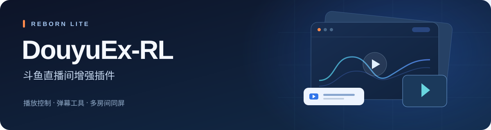
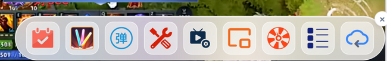
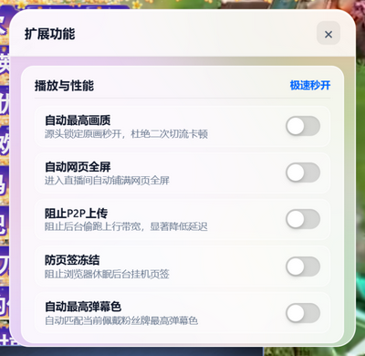
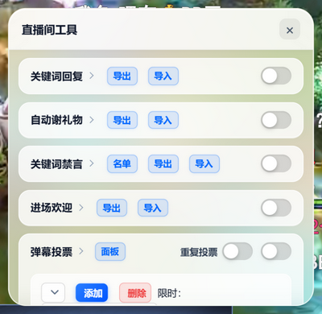

<p align="center">
  
</p>

<p align="center">
  给斗鱼网页版加上更顺手的播放控制、弹幕工具与日常任务。
</p>

<p align="center">
  <a href="https://greasyfork.org/zh-CN/scripts/595575-douyuex-rl-%E6%96%97%E9%B1%BC%E7%9B%B4%E6%92%AD%E9%97%B4%E5%A2%9E%E5%BC%BA%E6%8F%92%E4%BB%B6-reborn-lite"></a>
  <a href="CHANGELOG.md"></a>
  <a href="https://github.com/xayahcore/DouyuEx-RL/issues"></a>
</p>

<p align="center">
  <a href="#preview">界面预览</a> ·
  <a href="#features">功能亮点</a> ·
  <a href="#install">快速开始</a> ·
  <a href="#faq">常见问题</a> ·
  <a href="#development">开发与贡献</a>
</p>

---

<a id="preview"></a>
## 👀 界面预览

从精灵球展开工具条，播放、弹幕和任务各有入口。

<p align="center">
  
</p>

<table>
  <tr>
    <td align="center" width="50%">
      <strong>扩展功能</strong><br>
      <sub>画质、全屏与页面设置</sub><br><br>
      
    </td>
    <td align="center" width="50%">
      <strong>直播间工具</strong><br>
      <sub>回复、礼物与弹幕互动</sub><br><br>
      
    </td>
  </tr>
</table>

<sub>截图用于展示界面，具体菜单与功能以所装版本为准。</sub>

<a id="features"></a>
## ✨ 功能亮点

<table>
  <tr>
    <td width="50%" valign="top">
      <h3>🎬 播放随你调整</h3>
      <p>自动最高画质、网页全屏、画中画，让常用播放操作集中在一起。</p>
      <p>还可使用滤镜、倍速、局部缩放、截图、GIF 与直播流地址复制。</p>
    </td>
    <td width="50%" valign="top">
      <h3>🖥 多个直播间同屏看</h3>
      <p>最多 5 个斗鱼直播间同屏，支持拖拽换位、独立音量和画质设置。</p>
      <p>外房弹幕可合并显示，方便同时关注多个直播间。</p>
    </td>
  </tr>
  <tr>
    <td width="50%" valign="top">
      <h3>💬 弹幕按需整理</h3>
      <p>屏蔽重复弹幕与进场提示，调整弹幕背景；保留想看的内容，收藏想留下的发言。</p>
      <p>提供弹幕 +1、小尾巴、发送回执检测，以及投票、关键词回复等互动工具。</p>
    </td>
    <td width="50%" valign="top">
      <h3>🎁 日常任务集中管理</h3>
      <p>按项签到、看播积分、等级任务、粉丝牌明细和一键续牌。</p>
      <p>自动钓鱼、礼物红包与半自动宝箱可按需启用，通过各自的开关控制。</p>
    </td>
  </tr>
</table>

**还有这些小工具：** 广告及推广元素隐藏、排行榜贡献值、开播与本人观看时间、背包信息、账号切换、P2P 阻断、页面防自动暂停、关键词禁言与自动谢礼物。

> [!NOTE]
> 自动最高画质采用斗鱼返回列表中的首个有效档位，服务端权限限制仍适用。任务依赖登录状态、房间和活动规则；禁言等操作需要相应权限。

<a id="install"></a>
## 🚀 快速开始

| 步骤 | 操作 |
| :---: | --- |
| **01** | 在 Chrome 或 Edge 中安装 [Tampermonkey](https://www.tampermonkey.net/)。 |
| **02** | 在扩展详情中开启「允许用户脚本」。Chrome 138+ 可使用该开关；其他适用版本可启用开发者模式，详见[官方说明](https://www.tampermonkey.net/faq.php?locale=en&q=Q209)。 |
| **03** | 前往 [Greasy Fork 安装页](https://greasyfork.org/zh-CN/scripts/595575-douyuex-rl-%E6%96%97%E9%B1%BC%E7%9B%B4%E6%92%AD%E9%97%B4%E5%A2%9E%E5%BC%BA%E6%8F%92%E4%BB%B6-reborn-lite)，在油猴确认页完成安装。 |
| **04** | 刷新直播间，点击精灵球打开工具条，启用需要的功能。签到、领奖与账号相关功能需要登录斗鱼。 |

> [!TIP]
> 从原版或其他维护版切换时，**只启用一个 DouyuEx 版本**，然后刷新页面，避免重复绑定事件或执行任务。

<details>
<summary><strong>迁移、备份与更新</strong></summary>

迁移前在油猴管理面板导出旧脚本，并记录重要设置。配置分别保存在斗鱼站点的 localStorage 和油猴脚本存储中；只导出代码并不包含全部配置。同一浏览器可能沿用部分站点设置，其余需要重新配置。

首次使用时检查签到选项、送礼设置、钓鱼与红包开关，再开启需要的任务。P2P、防页签冻结等功能提示刷新时，请刷新使修改生效。

更新可通过油猴检查，或打开脚本的「版本更新」面板查看。完整记录见 [CHANGELOG.md](CHANGELOG.md)。

</details>

<a id="faq"></a>
## 💡 常见问题

<details>
<summary><strong>主播数据、历史弹幕查询还能用吗？</strong></summary>

`doseeing.com` 停服后，依赖它的「在看直播」统计条已移除。历史弹幕查询目前不可用，保留的入口会提示数据源停服；本地弹幕收藏是独立功能。

「扩展功能 → 在线工具」仍保留打开 `douyuex.com` 的按钮。它会跳转第三方网站，该站的可用性不由本脚本控制。

</details>

<details>
<summary><strong>为什么旧版的一些功能找不到了？</strong></summary>

已下线的房间／粉丝牌签到和钻粉联赛签到项已移除。旧版的虎牙、B 站及 iframe 单窗播放入口也已移除，当前同屏播放针对斗鱼直播间。

</details>

<details>
<summary><strong>画中画、防冻结和 P2P 阻断有什么限制？</strong></summary>

增强画中画需要浏览器支持相应 API。防页签冻结会调整页面可见性行为，但后台播放仍受浏览器节能策略影响。

P2P 设置针对 WebRTC 连接，不代表页面停止全部上传通信。判断是否生效应检查连接和数据通道，而不是仅凭开关状态或接口域名。

</details>

<details>
<summary><strong>开启后会更省资源吗？</strong></summary>

部分网络任务采用顺序执行和有限重试，音量设置保存使用防抖，XHR 请求体通过 WeakMap 关联。这些改动针对重复请求、频繁写入和对象引用保留。

实际 CPU、内存、带宽和起播时间仍取决于弹幕量、开启的功能、浏览器及网络环境；同屏、录制、画中画和自动任务也会增加负载。比较版本时应保持直播间、画质和功能设置一致，分别记录前台、后台及长时间运行的结果。

脚本在浏览器中运行，会按功能请求斗鱼接口、从 CDN 加载依赖，并访问 GitHub 或 Greasy Fork 等更新来源。网络权限见 [src/main.js](src/main.js) 中的元数据。

</details>

<a id="development"></a>
## 🛠 开发与贡献

使用 Node.js 24 和 npm，在仓库根目录执行：

```bash
npm ci
npm run build
npm test
```

构建生成根目录的 `DouyuEx_RL.user.js`，以及 `dist/` 中的展开版、压缩版和版本文件。请修改 `src/` 后重新构建，测试入口以 [package.json](package.json) 为准。

<details>
<summary><strong>目录、分支与验证约定</strong></summary>

```text
src/
├── core/       # 画质与排行榜等核心逻辑
├── packages/   # 页面组件与业务功能
├── require/    # Hook、协议、WebSocket 等公共代码
├── routers/    # 页面入口与初始化
├── common.js   # 公共函数与运行状态
└── main.js     # 元数据、模块接线与样式入口
tests/          # 源码及构建产物的回归测试
docs/           # 维护资料与截图
build.js        # 拼接、检查与压缩脚本
```

大改动和待实机验收的功能在 `DYEXRL-NEXT` 分支维护；`preview` 是发布基线，`main` 用于正式发布。分支、版本和发版约定见 [AGENTS.md](AGENTS.md)。

仓库目前没有 CI，提交前需手动执行构建和测试，发布合并后在 `main` 上重新验证。构建检查 CSS 嵌入、版本更新日志和 JavaScript 语法；`vm.Script` 不验证浏览器 API 或线上接口是否可用。涉及播放器、页面结构和账号操作的改动还需真实浏览器验证。

</details>

提交 [Issue](https://github.com/xayahcore/DouyuEx-RL/issues) 时，请附上浏览器、油猴和脚本版本，房间链接、相关开关、复现步骤，以及预期与实际结果。性能问题还请注明画质、同屏数量、前后台状态和运行时长。分享截图与日志前，请移除 Cookie、令牌和账号信息。

---

<p align="center">
  基于 <a href="https://github.com/qianjiachun/douyuEx">DouyuEx</a> 未混淆源码继续开发<br>
  感谢原作者小淳及所有贡献者 · 社区维护，与斗鱼官方无关<br>
  <sub>原项目于 2026 年 8 月停更 · 许可证信息见 <a href="package.json">package.json</a></sub>
</p>
